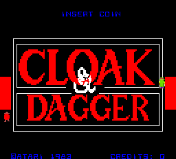
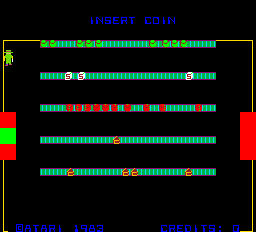
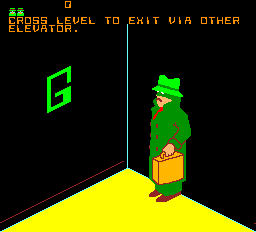
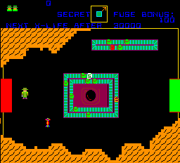

# Cloak & Dagger for MiSTer

## Overview

FPGA implementation of **Cloak & Dagger**, originally released by Atari, Inc. in March 1984.

Current status: functional behavioural implementation, mainly based on MAME/reference behaviour.

## How this core was developed

This core was developed with the help of AI coding tools, which I used to write the code where my own experience fell short. Its current behaviour is largely based on MAME.

I have compiled a netlist from the original Cloak & Dagger manuals, and I am now refactoring the core against it one circuit at a time, so that it moves closer to the original hardware.

## Screenshots

| | |
| --- | --- |
|  |  |
|  |  |

## Installation

1. Copy `releases/Arcade-CloakAndDagger_20261026.rbf` to `/_Arcade/cores/` as `CloakAndDagger_20261026.rbf`. The official Distribution installer removes the `Arcade-` prefix.
2. Copy `releases/Cloak & Dagger (rev 5).mra` to `/_Arcade/`.
3. Supply your legally obtained `cloak.zip` in `/games/mame/` and launch the MRA.

**Important:** Move older Cloak & Dagger RBFs outside `/_Arcade/cores/` before installing this release to avoid loading the wrong version.

No ROMs are included. The MRA retains the `cloak` game identity and settings namespace.

For additional information, see the [MiSTer Arcade ROM guide](https://github.com/MiSTer-devel/Main_MiSTer/wiki/Arcade-Roms).

## Controls and settings

Use the left directional controls for movement. Map Fire Left, Fire Right, Fire Up and Fire Down to a second stick or buttons, and Igniter to the fifth action button.

Start 1P, Start 2P and Coin use standard MiSTer mappings.

Two-player play alternates using the same upright controls; independent cocktail controls are not implemented.

OSD options include aspect ratio, credits/free play, Coin A/B, Demo Freeze, Service Mode, Self Test and Reset.

There is **no persistent NVRAM/high-score save/load support** yet. Scores and settings should not be expected to survive core reloads or power cycles.

## Credits and licences

**GPL-3.0-or-later covers harlock74's original contributions only.**

Inherited material retains its own terms and notices. The following table summarizes the main components and their respective credits and licensing information.

| Component | Credits | Applicable terms / reference |
|---|---|---|
| Original game integration, local adaptations, helpers, tests and tools | harlock74 | Scoped [owner grant](LICENSE); inherited wrapper terms remain |
| Adapted MAME Cloak driver algorithms | Dan Boris, Mirko Buffoni / MAME | [BSD-3-Clause notice](LICENSES/MAME-BSD-3-Clause.txt) |
| T65 CPU | Daniel Wallner, Mike Johnson, Wolfgang Scherr, Morten Leikvoll; additional revision credits retained in source | [Source/synthesized-form notice](LICENSES/T65-source-synthesized.txt) |
| POKEY | MikeJ / FPGAArcade (original implementation); harlock74 (local integration/adaptation) | [Source/synthesized-form notice](LICENSES/MIKEJ-POKEY-source-synthesized.txt), [provenance](docs/POKEY_PROVENANCE.md) |
| MiSTer framework | Sorgelig / Alexey Melnikov, Till Harbaum, Ludvig Strigeus, Grabulosaure, Kitrinx, bellwood420, Mike Simone and other Template contributors | File-specific GPL/LGPL notices and Template context; [licensing details](docs/LICENSING.md) |
| Avalon scaler | TEMLIB | [Original permissive notice](LICENSES/TEMLIB-scaler.txt) |
| SPDIF transmitter | Ultra-Embedded.com | GPL-2.0-or-later; header in `sys/spdif.v`, [licence text](LICENSES/GPL-2.0.txt) |
| PLL and reconfiguration IP | Intel / Altera | Original vendor notices and device-use restrictions; [licensing details](docs/LICENSING.md) |

For full third-party notices, licensing details and source provenance, see [NOTICE.md](NOTICE.md), [LICENSE](LICENSE), and the accompanying `LICENSES/` directory.

## Building the core

The project targets the Cyclone V **5CSEBA6U23I7** FPGA and uses **Quartus Prime Lite 17.0.2 Build 602**.

Open `CloakAndDagger.qpf` in Quartus and select **Full Compilation**.

Alternatively, from the project directory, run:

`quartus_sh --flow compile CloakAndDagger -c CloakAndDagger`

Required source files, IP, constraints and generator scripts are included in the repository.

The supplied release RBF is the previously tested build. A newly compiled RBF should be tested independently before distribution.

**Release SHA-256:**

`Arcade-CloakAndDagger_20261026.rbf`

`f589081a3bf7722bcaeb91379d938aaa21499b95db9a39a298b88dcd23589066`